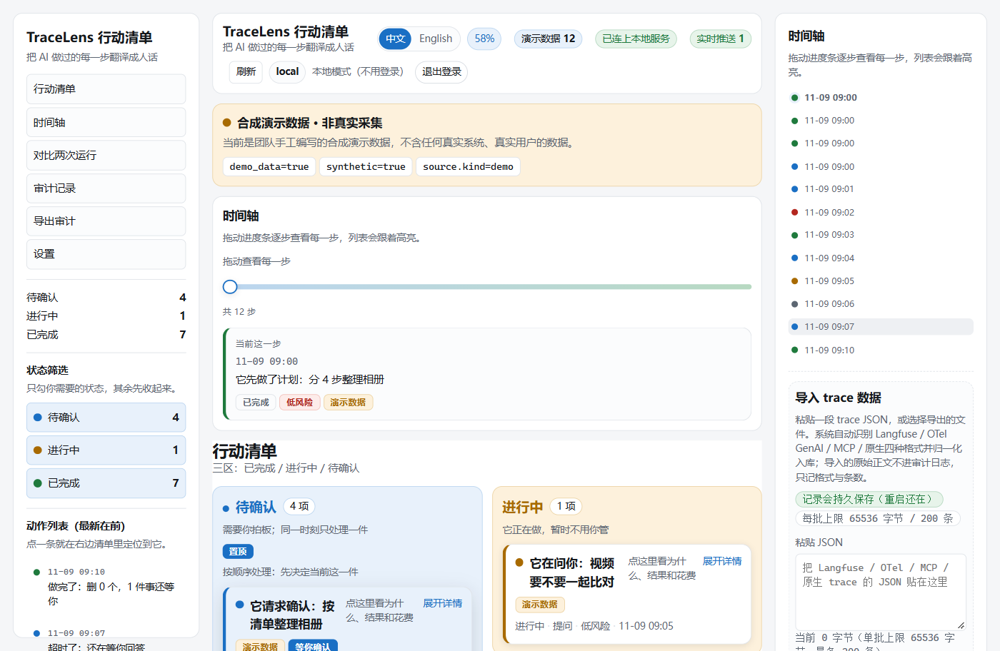

# TraceLens（行动透镜）

> ## 开源与声明（请先读 / Read first）
>
> - **许可证**：[Apache License 2.0](LICENSE)（OSI 认证开源许可证）。允许商用、修改、再分发；
>   作者**恳请**（非许可限制、不减损任何授权权利）在商业使用前联系项目发起人。归属与完整声明见 [NOTICE](NOTICE)。
> - **制作**：本项目采用 **qwen3.8-flash-next-iq3-s** 辅助制作。
> - **签名**：代码签名材料属**私有**，不随本仓库提供；Releases 中的 Windows 二进制为自签名，
>   仅证明完整性、不构成受信任发布者背书，请自行校验哈希。
> - **免责**：按「现状」（AS IS）提供，不附带任何明示或默示担保，作者不对使用后果承担责任（Apache-2.0 §7/§8）。
> - **仓库范围**：本仓库为**源码仓库**，不含 `node_modules`、构建产物、运行期数据、登录态与签名材料；
>   可运行的 Windows 应用见 GitHub Releases 附件。文档中的本机路径与主机标识已脱敏。
> - **第三方组件**：见 [docs/NOTICE-third-party.md](docs/NOTICE-third-party.md) 与 `THIRD_PARTY_LICENSES/`。
>
> **Open source.** Licensed under [Apache-2.0](LICENSE); built with **qwen3.8-flash-next-iq3-s**.
> Signing keys are private and not distributed. Provided AS IS; the authors do not assume liability.
> Commercial use is permitted — the authors kindly request (not a license condition) that you contact them first.
>
> ---
>


> **一句话**：AI 干活会留下一堆流水账。TraceLens 把它们翻成一张你能看懂、还能照着做的清单——
> 它做了什么、为什么这么做、现在要不要你拍板、你该点哪个按钮。装在自己电脑上就能用，团队也能放服务器上一起看。
>
> **In one line**: TraceLens turns raw AI-agent traces into a plain-language action list you can actually act on —
> what the agent did, why, whether it needs your decision right now, and which button to press.
> It runs standalone on your laptop, or as a team server via Docker.



**当前版本**：`0.5.0`（`/health` 上报的版本；数据契约 schema `1.1`）· **界面语言**：中文 / English（1115 个文案键、27 个域，双语 100%）

> **最近更新**：界面能热更新了，八个功能各有各的页面，界面重做，主动作页重排——不用重装。
> 想看人话版清单，直接读 [最近更新了什么](docs/25-whats-new.md)。

**先说清楚它不做什么。** 它不是又一个日志查看器。日志是给事后翻账用的，
它只关心一件事：*现在，要不要你点头？* 它把冷冰冰的技术流水变成一张人话清单，
并在"你点头"这件事上把话说死——**决定了 ≠ 生效了**。
你的决定会被记下来、进审计链；但执行端到底照没照做，得看它自己回传的回执。
回执没来就是"未上报"，界面绝不会替你宣布"已强制停止"。

---

## 0. 30 秒看懂界面

打开就是三栏，从左到右其实是一条时间线：**等你决定 → 正在做 → 已经做完**。记住下面几条，剩下的不用学：

| 你看到的 | 意思 |
| --- | --- |
| **三个区：待确认 → 进行中 → 已完成** | 顺序固定。待确认是**串行队列**：同一时刻只摆 1 件，其余显示"还有 N 件在排队" |
| **颜色** | 绿=完成、黄=进行中、红=失败、蓝=等你、灰=拒绝/跳过 |
| **一条卡片默认只有一句人话（L1）** | 点开"展开详情"才有 L2 分步说明、耗时、花费、工具参数与回执 |
| **顶部的"演示数据"横幅 + 每条记录的徽标** | 机器判定的：`demo_data=true`、`synthetic=true`、`source.kind=demo` 同时命中才出现。换成真实数据，横幅与徽标全部消失 |
| **手机**：悬浮球 → 底部面板 → 三区；右上「更多」 | 设置 / 审计 / 用户管理 / 导入 / 导出 / 语言切换，手机全部可达（按权限禁用并写明原因） |
| **桌面（≥1024px）**：侧栏 + 三区 + 时间轴 | 侧栏可选状态筛选、点一条定位、拖时间轴、两种运行并排对比 |

> 所有演示数据都是**团队手工编写的合成样例**，不含任何真实人名、路径、金额或客户数据
> （见 [samples/README.md](samples/README.md)）。

---

## 1. 我该用哪种形态？

| 我是谁 | 用哪个 | 需要什么 | 数据放哪 |
| --- | --- | --- | --- |
| 只想自己先看看 | **便携版 `TraceLens-0.5.0-win-x64-portable.exe`**（单文件，免安装） | Windows 10/11 x64 | Electron 用户数据目录（默认 `%APPDATA%\<应用名>\data`；可用环境变量 `TRACELENS_DATA_DIR` 指定） |
| 想装到开始菜单、要卸载项 | **安装包 `TraceLens-0.5.0-win-x64-Setup.exe`**（NSIS，自签名） | Windows 10/11 x64 | 同上（Electron 用户数据目录；两者共用同一份数据） |
| 团队一起看、要账号和审计 | **Docker 镜像 + compose（team 模式）** | 已装 Docker Desktop（WSL2 后端） | 宿主的 `./data`（绑定挂载，可备份） |
| 我要改代码 / 做二次开发 | **源码**（需要 Python 3.12+） | Python 3.12+ | 仓库下 `var/`（可用 `--data-dir` 改） |

三种形态跑的是**同一份应用**、同一套数据契约、同一套审计链，界面完全一致。

---

## 2. 30 秒快速开始（三条路，命令都实测过）

### 2.1 团队：Docker Compose（推荐）

```bash
cd agent-explainer
cp scripts/env.example .env        # 至少把 TRACELENS_ADMIN_PASSWORD 换成真口令（≥10 位）
docker compose up -d               # 若本地没有镜像会先构建
docker compose ps                  # 等 STATUS 变成 healthy（start_period 15s、interval 30s）
curl -s http://127.0.0.1:8765/health    # 200 且 "status": "ok"（注意：没有 /api/health）
```

打开 `http://127.0.0.1:8765/`，用 `admin` + `.env` 里的口令登录（首次登录会被要求改密）。
注意：`TRACELENS_ADMIN_PASSWORD` **只在用户表为空（首次初始化）时**用作初始口令；
如果 `./data` 里已经有账号（例如复用旧数据卷），它不会覆盖已有口令，请沿用原来的账号口令。
同事在同一局域网用 `http://<这台机器的IP>:8765/` 访问。细节（角色、卷、备份、升级、离线 tar）见
[docs/05.4-docker.md](docs/05.4-docker.md)。

### 2.2 个人：便携版（双击即用）

1. 把 `TraceLens-0.5.0-win-x64-portable.exe` 放到任意可写目录；
2. 双击运行，等它把界面加载出来（首次启动会写演示数据）；
3. 关掉窗口即退出。**数据不在 exe 旁边**：便携版与安装版一样，用户数据在 Electron 的用户数据目录里
   （默认 `%APPDATA%\<应用名>\data`，应用名取 `desktop/package.json` 的 `productName`；
   想固定到一个你记得住的位置，就在启动前设 `TRACELENS_DATA_DIR=D:\TraceLensData`）。

### 2.3 开发者：源码直跑（无需任何第三方库）

```bash
cd agent-explainer
python -m agent_explainer --mode local --port 8765 --demo zh     # 首次启动写 12 条合成演示记录
# 浏览器打开 http://127.0.0.1:8765/
```

不需要 pip install：核心运行时**纯标准库**（离线可用；LLM 润色是可选项）。

---

## 3. Windows 安装包（Setup.exe）

> ⚠️ **路径要求（本机已复现）**：安装包与便携版请放在**纯 ASCII 路径**（例如 `E:\TraceLens-0.5.0\`）再运行。
> 从含中文的目录（例如 `E:\DEEPSEEK 黑奴\...`）双击会报 NSIS `Error writing`；同一文件在 ASCII 路径下
> `/S` 静默安装退出码 0（0.4.5 时点实测；0.5.0 的 NSIS 构建也因此**固定**在 ASCII 目录里产出，
> 见 [docs/audit/v050-desktop.md](docs/audit/v050-desktop.md) §3.2）。复制一份到纯英文目录再装，不改变字节。

| 项 | 值 |
| --- | --- |
| 文件 | `release/TraceLens-0.5.0-win-x64-Setup.exe` |
| 大小 / SHA256 | 151,838,192 字节 / `37cf69638a21368631eaccee3cb7c180a365f6b4265ecbd25ac7747a60e0395d`（逐字取自 `release/SHA256SUMS.txt`） |
| 安装方式 | 双击按向导装（可选安装目录），或静默安装：`.\TraceLens-0.5.0-win-x64-Setup.exe /S` |
| 安装后 | 开始菜单出现 TraceLens；启动 → Electron 壳拉起内置 sidecar → 等 `/health` 就绪 → 加载界面 |
| 卸载 | Windows"应用和功能"里卸载 TraceLens（**不会**删除用户数据目录） |
| 签名 | 自签名证书 `CN=TraceLens Self-Signed (Local Only)`（`release/TraceLens-SelfSigned.cer`），签名**有效**但根证书不受信任 |
| 本机实测 | 哈希、字节数、签名状态（`UnknownError` + 指纹 `DF1CB56A…`）逐条复算通过；**0.5.0 的 `/S` 静默安装未实测**（安装目标目录属 DSH 服务账号，见 [docs/audit/v050-desktop.md](docs/audit/v050-desktop.md) 未做项）；`/S` 退出码 0 是 **0.4.5 时点**的实测记录 |

**关于 SmartScreen（必读）**：这是自签名包，双击时 Windows 可能弹
"Windows 已保护你的电脑"。点**"更多信息"→"仍要运行"**即可。自签名只证明两件事：
文件出自这份密钥、内容没被改过；它**不是**"受信任发布者"，企业 AppLocker/WDAC 仍可能拦。
想彻底消除提示：买 OV/EV 代码签名证书重签，或在**自己的机器**上把 `TraceLens-SelfSigned.cer`
导入"受信任的根证书颁发机构"（仅开发机这么干，别当正式发行）。

**安装后请自测**：本包的图形界面**没有**在构建会话里启动验证过（构建沙箱的 Electron
crashpad 受命名管道限制，GUI 起不来，见 [docs/05.3-release-checklist.md](docs/05.3-release-checklist.md) §9）。
请在你的真实桌面会话里双击安装、启动一次，确认窗口能打开、能看到 12 条演示清单；
若失败，请把 [docs/06-feedback-form.md](docs/06-feedback-form.md) 里的"故障"一栏连同截图回传。

---

## 4. 便携版（免安装）

| 形态 | 文件 | 大小 | SHA256（前 16） | 说明 |
| --- | --- | --- | --- | --- |
| 免安装可执行 | `release/TraceLens-0.5.0-win-x64-portable.exe` | 137,883,824 | `8bdc55a089dd678d` | 双击运行，自带 Python 与界面（首次运行先解压到系统临时目录；用户数据仍落 Electron 用户数据目录）。哈希逐字取自 `release/SHA256SUMS.txt` |
| 源码便携包 | `desktop/build/dist/TraceLens-0.5.0-win-x64-portable-src.zip` | 4,957,816 | `098c3bcd472842c1` | 需要系统 Python 3.12+；解压后 `start.cmd` 开界面、`start-sidecar.cmd` 走 sidecar 模式（start.cmd 已带 `--features`，总裁办账本落用户目录）；数据落同目录 `data\`。哈希逐字取自 `release/tracelens-0.5.0-release/SHA256SUMS-bundle.txt`（`source/…` 那行） |

**用户数据到底在哪（两个桌面形态都一样）**：Electron 的 `app.getPath('userData')` 下的 `data` 目录，
默认形如 `%APPDATA%\<应用名>\data`，应用名取 `desktop/package.json` 的 `productName`（当前是 `TraceLens 桌面端`）。
想彻底掌控位置就在启动前设环境变量 `TRACELENS_DATA_DIR`（桌面壳优先用它），备份时直接拷这个目录。
（本轮构建会话没能启动 GUI，所以"默认目录的确切名字"以你首次启动后 `%APPDATA%` 下实际出现的目录为准。）

源码便携包内附 `README-便携版.txt`（原文：需要系统 Python 3.11+；本产品按架构口径要求
**3.12+**，本机在 3.14.7 上实测通过）。

---

## 5. Docker Compose 部署（团队模式）

前置：Docker Desktop（WSL2 后端，**Linux 容器模式**）。先跑 `docker info` 确认可用——
不可用时**不要**继续，先解决 Docker。

```bash
cd agent-explainer
cp scripts/env.example .env                  # 必填 TRACELENS_ADMIN_PASSWORD；可选 LLM / 端口 / 语言
docker compose up -d
docker compose ps                            # STATUS: healthy 才算就绪
curl -s http://127.0.0.1:8765/health         # {"status":"ok", "mode":"team", "auth":{"required":true,...}}
docker compose logs -f tracelens             # 跟随日志（同时落 ./logs/tracelens-YYYYMMDD.log）
docker compose down                          # 停容器（数据留在 ./data）
```

**没有 Docker？** 用离线镜像包（已导出并校验）：

```bash
docker load -i release/0.5.0/tracelens-0.5.0-image.tar   # → Loaded image: tracelens:0.5.0
sha256sum -c release/0.5.0/SHA256SUMS.txt                # tracelens-0.5.0-image.tar: OK（64,029,696 字节）
docker run -d --name tracelens -p 8765:8765 \
  -v "$PWD/data:/app/var" -v "$PWD/logs:/app/logs" \
  -e TRACELENS_ADMIN_PASSWORD='至少10位的口令' \
  --entrypoint /usr/local/bin/tracelens-entrypoint \
  tracelens:0.5.0 python -m agent_explainer --mode team \
    --host 0.0.0.0 --port 8765 --demo zh --data-dir /app/var --features /app/var/features
```

> `--features /app/var/features` 是 5.0 总裁办账本（身份账本 + 密钥库）的根：默认值
> `<应用根>/var/features` 不跟随 `--data-dir`，显式钉在挂载卷里才不会被换镜像冲掉
> （口径与 `scripts/docker-run.sh`、`docker-compose.yml` 一致，见 [docs/05.4-docker.md](docs/05.4-docker.md) §7）。

**团队模式的账号与权限**（服务端强制，前端只负责隐藏入口）：

| 角色 | 能做什么 |
| --- | --- |
| `admin` | 全部：改设置（含模型配置）、管用户、决定、导入、看/导出审计 |
| `editor` | 决定、导入、看/导出审计；**不能**改设置、不能管用户 |
| `viewer` | 只读：看记录、看/导出审计；不能决定、不能导入（点了会拿到 403 `ROLE_FORBIDDEN`） |

首个 `admin` 用 `.env` 里的 `TRACELENS_ADMIN_PASSWORD` 创建（**仅首次初始化**：`./data` 里已存在账号时该变量不再生效），首次登录强制改密。
忘记口令、卷权限、健康检查排障、备份/升级/回滚，全部写在
[docs/05.4-docker.md](docs/05.4-docker.md)（含 14 条 FAQ 与可复现命令）。

---

## 6. 三种接入方式（把 Agent 的动作送进来）

### 6.1 先看演示数据（默认就是）

首次启动会写入 12 条**合成**演示记录（`zh`）或英文 12 条（`--demo en`）；`--demo none` 从 0 条开始。

### 6.2 粘贴 / 上传（人工，一次性）

界面里两处入口：桌面 → 侧栏"导入数据"，手机 → 「更多」→"导入数据"。粘贴 JSON 文本，
或选择文件（读文本内容），点导入。前端会先拦空内容 / 非法 JSON / 超过 64KB（0 次请求），
服务端仍是权威（超限 413、格式不认识 400，错误文案不打印服务端原文）。

命令行等价物（**已实测**：`samples/traces/mcp_events.json` → 9 条导入，记录数 12 → 21）：

```bash
python - <<'PY' | curl -s -X POST http://127.0.0.1:8765/api/import \
  -H "Content-Type: application/json" --data-binary @-
import json
print(json.dumps({"payload": open("samples/traces/mcp_events.json", encoding="utf-8").read(),
                  "filename": "mcp_events.json"}, ensure_ascii=False))
PY
```

> 为什么用管道而不是 `--data-binary @/tmp/x.json`：Windows 自带的 `curl.exe` 不认 MSYS 的 `/tmp`
> 路径（会报 "error encountered when reading a file"）；`@-` 读标准输入，Windows / Linux / macOS 都一样。

支持四种格式（自动识别，也可显式指定）：Langfuse 导出（`langfuse`）、OTel GenAI / OTLP（`otel_genai`）、
MCP 事件流（`mcp_events`）、原生 ActionRecord（`native`）。样例在 [samples/traces/](samples/traces)。

### 6.3 实时（机器对机器：webhook / SDK / SSE）

```bash
# 1) 团队模式先签发一个上报令牌（admin 在界面「用户管理」附近，或调 API；明文只显示一次）
#    local 模式可匿名上报、无需令牌（只监听回环地址）
# 2) 上报一条动作。原生 ActionRecord 的必填字段很多（27 个），最稳的做法是拿一条现成记录当模板：
python - <<'PY' | curl -s -X POST http://127.0.0.1:8765/api/ingest/events \
  -H "Content-Type: application/json" \
  -H "X-TraceLens-Ingest-Token: tlk_你的令牌" \
  --data-binary @-
import json
rec = json.load(open("samples/action_records.json", encoding="utf-8"))["records"][0]
rec["id"] = "act-my-agent-0001"      # 换 id，避免和演示记录冲突
rec["status"] = "running"
rec["user_intervention"] = None      # 上报只写事实，不写决定
print(json.dumps({"events": [rec]}, ensure_ascii=False))
PY
# 期望：{"ok": true, "accepted": 1, "created": 1, ...}（local 模式省略令牌头即可，实测同结果）
# 3) 界面实时看到（SSE）：浏览器打开页面即可，顶栏会显示 live；断线自动降级轮询
```

**SDK 示例**（一条命令跑完，全程离线、跑完自动关服务；**已实测 exit 0**）：

```bash
python samples/sdk_demo.py
# 期望结尾：sdk_demo: OK —— 边跑边上报、实时推送、落库事实都符合约定
# 实测：12 帧推送（seq 单调 1..12）、服务端 16 条记录、其中 4 条来自实时上报
```

SDK 在 `agent_explainer/sdk/`：`TraceLensClient.log_action / update_action / @track / stream_events`。
上报只写**事实字段**，永远不会替你写决定（`user_intervention` 保持 `null`），也不会谎报执行结果。

---

## 7. 模型配置（可选，不配也能用）

不配就是**模板模式**（`mode=template`）：完全离线、零第三方依赖，功能不缺。
想让解释更顺，可以接模型：

| 方式 | 怎么做 |
| --- | --- |
| Docker | `.env` 里填 `TRACELENS_LLM_MODE=llm`、`TRACELENS_LLM_PROVIDER`、`TRACELENS_LLM_BASE_URL`、`TRACELENS_LLM_MODEL`、`TRACELENS_LLM_API_KEY`；非回环地址还要 `TRACELENS_LLM_ALLOW_OUTBOUND=1`（否则 403 `LLM_OUTBOUND_BLOCKED`） |
| 桌面 / 源码 | 界面"设置"里填；`admin`（或 local 模式）才能保存 |
| 探测 | 设置页"测试连接"只发一条固定自检提示，不会把你的数据发出去 |

**密钥边界**：team / 容器模式密钥**只走环境变量、不落盘**；local 模式在 Windows 上可用 DPAPI 加密存盘。
接口永远只回掩码（`••••••` + 末 4 位）与指纹，拿不到可还原形式。

---

## 8. 审计与导出（给"事后要拿证据"的场合）

- 每次登录、决定、导入、导出、上报都会**追加**一条审计（`audit.jsonl`），哈希链串起来；
  断链时接口返回 500 `AUDIT_CHAIN_BROKEN` 且**不输出半条证据**（不假装完整）。
- PII 在**写盘前**强制打码（13 类模式，形如 `<redacted:email#sha256:ab12cd34ef56>`），
  查看、导出、CSV/HTML/PDF 三处同源；**没有**"关闭打码"的开关。
- 导出：审计面板选 CSV / HTML / PDF（PDF 需要镜像里带 reportlab；桌面/源码环境没有就自动回退可打印 HTML）。

```bash
# 命令行等价物（实测返回 200 text/csv；字节数随审计条目增长，不是固定值）
curl -s -o audit.csv "http://127.0.0.1:8765/api/audit/export?format=csv"
```

---

## 9. 界面语言与手机

- 右上"语言切换"或手机上「更多」→"语言切换"：中英即时切换，**不丢记录**（导入的、已批准的都不会消失），
  筛选、展开的卡片、时间轴位置保持不动。
- 英文界面连演示数据也是英文（`samples/action_records_en.json` 的原生英文，零汉字）。
- 手机（375px）可用：顶栏「更多」里六个入口按权限与在线状态启用/禁用，禁用会**写明原因**。

---

## 10. 目录结构（交付包里都是什么）

```
agent-explainer/
├─ agent_explainer/            # 产品本体（纯标准库）
│  ├─ server.py               # HTTP 服务、路由、鉴权、审计装配
│  ├─ trace_adapter.py        # 四种 trace 格式 → ActionRecord
│  ├─ explanations.py         # 人话翻译（模板 / 可选 LLM）
│  ├─ audit.py auth.py ingest.py settings.py store.py
│  ├─ sdk/                    # Python SDK（实时上报）
│  ├─ prompts/                # LLM 提示词（zh/en）
│  └─ web/                    # 单页界面（零构建、零依赖）+ verify/ 截图
├─ desktop/                    # Electron 壳 + PyInstaller sidecar + 打包资源
│  └─ build/resources/sidecar/ # 打包版 sidecar（node 引擎，免 Python）
├─ samples/                    # 合成演示数据 + 三种外部格式样例 + SDK 演示脚本
├─ docs/                       # 产品/数据模型/架构/测试/交付文档 + JSON Schema
├─ scripts/                    # Docker 一键构建/运行/验收脚本
├─ tests/                      # 自动化测试（754 条；其中 2 条依赖沙箱 TEMP/网络，受限环境会红）
├─ tools/                      # 校验与生成脚本（doc_lint / i18n_lint / 契约生成…）
├─ Dockerfile  docker-compose.yml  .dockerignore
├─ release/                    # 交付产物：安装包 / 便携版 / .cer / SHA256SUMS / Docker 镜像 tar
├─ README.md  LICENSE  CHANGELOG.md
└─ var/  data/  logs/          # 运行期数据（不入库、不进镜像）
```

---

## 11. 已知限制（交付即生效，请先读）

| # | 限制 | 影响 / 绕法 |
| --- | --- | --- |
| 1 | **SSE 跨窗口推送**：本机实测 SSE 显示 `live` 时，别的客户端做的决定没有帧推到本页 | 页面已有"决定帧强制合并 + 4 秒降级轮询"兜底，最迟 4 秒可见；根因在服务端/环境，未在本版修 |
| 2 | **导入记录的任务名**可能显示"文案缺失：demo.label.…" | 该运行名没有对应字典键；不影响数据与决定 |
| 3 | **导出页脚**没有"合成演示数据"标记（HTML/PDF） | 演示数据的横幅只在页面里；导出文件请自行确认来源。QA 不得宣称已具备 |
| 4 | **viewer 也能导出审计** | 规格如此（`audit.export` 四角色都有），不是缺陷 |
| 5 | **桌面 GUI 未在构建会话内验证** | 安装包/便携版已通过哈希、签名、静默安装检查；请在你的桌面双击自测（本 README 第 3 节） |
| 6 | **单文件 sidecar exe 未产出** | PyInstaller 单文件在本机引导阶段建不出解包目录，交付布局是 onedir（不影响安装包/便携版） |
| 7 | **单进程设计** | 不要用多副本共享同一 `./data`；没有主从与冲突合并 |
| 8 | **没有内置 TLS** | 暴露到内网/公网请前面放 nginx/Caddy 做 TLS 终结（未随包提供，也未实测反代） |
| 9 | ~~**版本号两处不一致**~~ 已收口（0.5.0） | 历史上 `__init__.py:__version__=0.1.0` 与 `SERVER_VERSION=0.4.5` 不一致；0.5.0 起两处都是 `0.5.0`（单一来源仍是 `server.py:SERVER_VERSION`，`--check` 会比对） |
| 10 | 数据全是合成样例 | 真实效果取决于你接入的真实 trace；演示数据不代表真实用户行为 |
| 11 | **安装包/便携版必须从纯 ASCII 路径运行** | 中文路径会报 NSIS `Error writing`；请先复制到 `C:\`、`E:\TraceLens-0.5.0\` 等纯英文目录再双击（ASCII 路径 `/S` 退出码 0 是 0.4.5 时点实测；0.5.0 的 NSIS 构建固定在 ASCII 目录产出） |
| 12 | **含中文的 UTF-8 无 BOM `.ps1` 会被 PowerShell 5.1 当 ANSI 读 → 解析失败** | 把你自己的验收/部署脚本存成 **UTF-8 with BOM** 或纯 ASCII 再 `powershell -File` 跑；直接粘贴进控制台不受影响。本仓库自带的 `tools/sign_and_hash.ps1` 已带 BOM（`-CheckEncoding` 会自报「BOM=True」）。2026-11-12 实测复现：带中文注释的无 BOM 探针报 `Unexpected token 'W' in expression or statement` / `The string is missing the terminator`，改成纯 ASCII 后同一条命令跑通 |

---

## 12. 交付清单与完整性校验

| 产物 | 路径 | 字节 | SHA256（前 16） | 签名 / 状态 |
| --- | --- | --- | --- | --- |
| Windows 安装包（NSIS） | `release/TraceLens-0.5.0-win-x64-Setup.exe` | 151,838,192 | `37cf69638a213686` | 自签名，签名落了但根不受信任（`UnknownError`、`signatures_applied=2`、`signed_count=0`） |
| 便携版（免安装） | `release/TraceLens-0.5.0-win-x64-portable.exe` | 137,883,824 | `8bdc55a089dd678d` | 自签名，同上 |
| 自签名公钥证书 | `release/TraceLens-SelfSigned.cer` | 814 | `5f8a6044ab2fef48` | 导入"受信任的根"可消除提示（仅开发机） |
| 校验与签名状态 | `release/SHA256SUMS.txt`、`release/SIGNATURE-STATUS.json` | 205 / 4,918 | — | `unsigned=true`、`signatures_applied=2`、`signed_count=0`、`trust_state=self_signed_root_untrusted`（如实：自签名只证明完整性，不证明信任） |
| 源码便携包 | `desktop/build/dist/TraceLens-0.5.0-win-x64-portable-src.zip` | 4,957,816 | `098c3bcd472842c1` | 未签名（zip 不签）；`start.cmd` 已带 `--features` |
| 打包版 sidecar（onedir） | `desktop/build/resources/sidecar/agent-explainer-sidecar/agent-explainer-sidecar.exe` | 10,403,499 | `f00527ca2c9ac567` | 未签名（内部组件）；与安装包/便携版内的那份逐字节相同（`desktop/build/resources/sidecar/BUILD-INFO.json`，built_at 2026-11-12T01:51:23） |
| Docker 镜像离线包 | `release/0.5.0/tracelens-0.5.0-image.tar` | 64,029,696 | `d93d1803c6ecff90` | 镜像 `tracelens:0.5.0` = `sha256:6cb84171…`、246,561,040 字节（`release/0.5.0/IMAGE-INFO.json`），非 root |
| Docker 编排 | `Dockerfile`、`docker-compose.yml`、`.dockerignore`、`scripts/` | — | — | `scripts/docker-verify.sh` 结论「全部通过」（[docs/audit/v050-docker.md](docs/audit/v050-docker.md) §12） |
| 源码 | 本仓库（许可证见 `LICENSE`） | — | — | — |
| 演示数据 | `samples/action_records.json`（12 条）、`samples/action_records_en.json`（12 条）、`samples/traces/`（8/7/9 条） | — | — | 全部合成，非真实采集 |
| SDK 示例 | `samples/sdk_demo.py` + `agent_explainer/sdk/` | — | — | 实测 exit 0（12 帧 / 4 条实时） |
| 许可与变更记录 | `LICENSE`（Apache-2.0）、`NOTICE`、`CHANGELOG.md` | — | — | 第三方许可见 [docs/NOTICE-third-party.md](docs/NOTICE-third-party.md) |

校验命令（Windows 原生，任选一条；**已实测**）：

```powershell
# 单个文件（无需装任何工具）
certutil -hashfile TraceLens-0.5.0-win-x64-Setup.exe SHA256
(Get-FileHash -Algorithm SHA256 .\TraceLens-0.5.0-win-x64-Setup.exe).Hash

# 签名状态（自签名预期 UnknownError：签名落了、根不受信任，不是"没签"）
(Get-AuthenticodeSignature .\TraceLens-0.5.0-win-x64-Setup.exe).Status
```

```bash
# Git Bash / WSL：SHA256SUMS.txt 是 CRLF 写的，先去掉 \r 再校验
cd release && tr -d '\r' < SHA256SUMS.txt | sha256sum -c -                   # 两个 0.5.0 exe
cd release/tracelens-0.5.0-release && sha256sum -c SHA256SUMS-bundle.txt     # 总包每一条目
```

镜像包校验：`cd release/0.5.0 && sha256sum -c SHA256SUMS.txt` → `tracelens-0.5.0-image.tar: OK`。

> **0.5.0 总包已产出**：`release/tracelens-0.5.0-release.zip` = 安装包 + 便携版 + 源码便携包 +
> Docker 镜像 tar + 文档 + 证书 + 校验文件；zip 条目集合 == 目录文件集合、全部 ZIP_STORED。
> 它的**字节数与 SHA256 的权威值只写在 `release/SHA256SUMS-release.txt` 第 2 行**——本文就在那只 zip
> 里面，写死自己的哈希必然失效（自引用不可达），所以这里故意不写数字；两轮实测哈希的完整过程照
> [docs/audit/v050-docker.md](docs/audit/v050-docker.md) §12.5 的写法留痕。
>
> **历史快照（0.4.5 时点，不要拿去当 0.5.0 的校验值）**：
> `release/tracelens-0.4.5-release.zip` 实测 **356,074,424 字节 / `0c5d5552aa78c6b2ab0c6c2d79ffa3baae1028f191d63bdb74410aff442139ab`**
> （逐字取自 `release/SHA256SUMS-release.txt` 第 1 行）。本文旧版写的 `356,073,874 B / ef837389db3b…`
> **两个数字都是错的**，已按实测更正（逐条 before→after 见 [docs/audit/v050-docs-sync.md](docs/audit/v050-docs-sync.md)）。
> 0.4.5 单件的哈希经逐条实测仍然为真（保留在此供老包核对）：Setup 151,535,616 / `78313951bd1baf553a8e90df9c8060421af7b59b6ea517d600aa3befcb8f4edb`、
> portable 137,607,264 / `6394bf6cf5fb1474f3694cea91c704b78ff631d9e8fa6cade9bba357200acf45`、
> 源码便携包 3,483,619 / `c8aa59068f61b2f4b9ffca374740750202c41cc0981c359363dc60fdf49e7f8d`、
> 镜像 tar 63,299,584 / `6a738832c7d2632f741ff2d1da7b469fdc63e91162e1df839b1099c280e2170d`
> （来源：`release/tracelens-0.4.5-release/SHA256SUMS.txt`、`release/0.4.5/SHA256SUMS.txt`；
> 源码便携包不在 0.4.5 清单内，是对包内那份直接计算的）。

---

## 13. 文档地图

| 文档 | 给谁看 |
| --- | --- |
| [docs/25-whats-new.md](docs/25-whats-new.md) | **人话版更新说明**：这一版比最初多了什么、为什么值得升级 |
| [docs/01-product-and-users.md](docs/01-product-and-users.md) | 产品定义、用户分层、成功指标 |
| [docs/02-data-model.md](docs/02-data-model.md) | 数据契约（ActionRecord v1.1）、字段与枚举 |
| [docs/03-architecture.md](docs/03-architecture.md) | 架构、端点清单、错误码、`/health` 字段、依赖政策 |
| [docs/05-test-plan.md](docs/05-test-plan.md) · [05-test-report.md](docs/05-test-report.md) | 测试计划 / 模拟走查报告（**模拟数据，非真人测试**） |
| [docs/05-real-user-kit.md](docs/05-real-user-kit.md) · [docs/06-feedback-form.md](docs/06-feedback-form.md) | 真实用户实测包 / 反馈模板 |
| [docs/05.3-release-checklist.md](docs/05.3-release-checklist.md) | 桌面打包与端到端联调清单（含未产出项与原始报错） |
| [docs/05.4-docker.md](docs/05.4-docker.md) | Docker 构建 / 部署 / 备份 / 升级 / FAQ |
| [docs/06-user-guide.md](docs/06-user-guide.md) | **非技术用户操作手册**（10 分钟上手） |
| [docs/06-faq.md](docs/06-faq.md) | 常见问题（安装、登录、导入、审计、Docker） |
| [docs/api_contract.json](docs/api_contract.json) · [docs/schemas/](docs/schemas) | 机器可读接口契约 / JSON Schema |

---

## 14. English Quick Start

**What it is.** TraceLens converts AI-agent traces into a plain-language action list:
what the agent did, why, whether it needs your decision, and which button to press.
Three zones (Needs you → In progress → Done), colour-coded, with a hash-chained audit trail.
Decisions are recorded — **a decision is not an effect**; the execution receipt is shown as reported,
never faked.

**Pick your form.** Windows installer or portable exe (x64, double-click), or Docker for a team server,
or run from source with Python 3.12+.

```bash
# Team server (Docker Desktop required; Linux containers)
cd agent-explainer
cp scripts/env.example .env     # set TRACELENS_ADMIN_PASSWORD (>= 10 chars)
docker compose up -d
curl -s http://127.0.0.1:8765/health     # 200 with "status": "ok" (there is no /api/health)
# open http://127.0.0.1:8765/ , sign in as admin, change the password on first login
```

```bash
# From source (no third-party packages required)
python -m agent_explainer --mode local --port 8765 --demo zh
# open http://127.0.0.1:8765/
```

```bash
# Offline image (already exported and checksummed)
docker load -i release/0.5.0/tracelens-0.5.0-image.tar     # → Loaded image: tracelens:0.5.0
sha256sum -c release/0.5.0/SHA256SUMS.txt                  # 64,029,696 bytes → OK
```

**Bring your own data.** Import pasted JSON or a file (Langfuse / OTel GenAI / MCP events / native
ActionRecord are auto-detected), or stream in real time via `POST /api/ingest/events` (scoped ingest
token) and the Python SDK in `agent_explainer/sdk/` (`python samples/sdk_demo.py` runs a full offline demo).

**Audit & export.** Every login, decision, import, export and ingest batch appends to `audit.jsonl`
with a hash chain; PII is redacted before it is written. Export CSV/HTML/PDF from the audit panel or via
`GET /api/audit/export?format=csv`. A broken chain returns 500 and refuses to emit partial evidence.

**Known limitations.** Cross-window SSE push for decisions is not delivered in this build (the page falls
back to forced merge plus 4-second polling); exported HTML/PDF lacks the "synthetic demo data" footer;
the desktop GUI was **not** launched in the build session (verify it yourself after installing);
single-process design (do not share one `./data` between replicas); TLS is not bundled
(put nginx/Caddy in front). See section 11 for the full list.

**License.** [Apache License 2.0](LICENSE) — commercial use, modification and redistribution are
permitted under the license terms; see [NOTICE](NOTICE) for attribution. The authors kindly request
(not a license condition) that you contact them before commercial use. Built with qwen3.8-flash-next-iq3-s;
signing keys are private and not distributed; provided AS IS without warranty or liability.

---

## 15. 许可证与安全提示

- `LICENSE`：**Apache License 2.0**（OSI 认证开源许可证）——允许商用、修改、再分发与对外提供服务；
  条件为保留版权与许可声明、修改文件须标注、随附 [NOTICE](NOTICE)，并含明确专利授权。
  作者恳请（非许可限制）商用前联系项目发起人。第三方组件按各自许可证分发
  （见 [docs/NOTICE-third-party.md](docs/NOTICE-third-party.md) 与 `THIRD_PARTY_LICENSES/`）。
- 数据只存本地 / 你自建的卷，默认**不出网**（LLM 需显式配置才连外网）。
- 生产部署请放在 TLS 反代之后，并把 `./data` 纳入备份；审计是 append-only，**不要手改** `audit.jsonl`。
